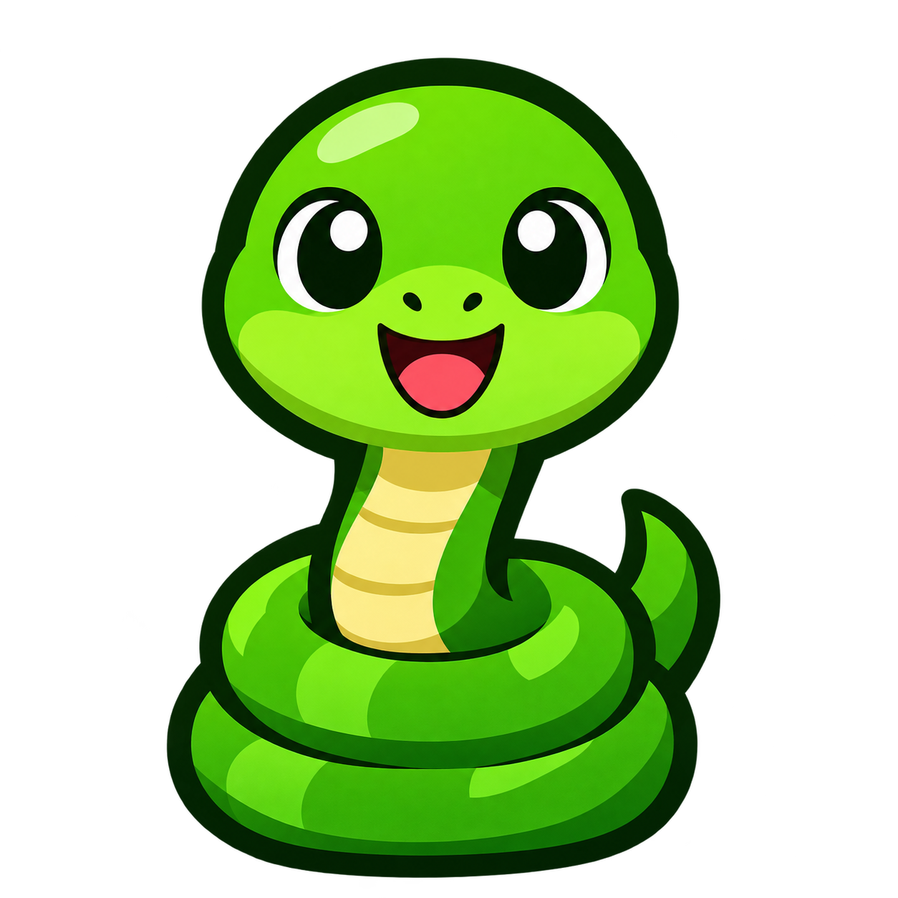

# MySnake · 貪食蛇



用 Go 寫的原生 Windows 貪食蛇。控制小蛇吃食物、拉長身體，試著在撞牆或撞到自己之前刷新最高分。

## 開始遊戲

需要 **Windows 與 Go 1.24 以上版本**。在 PowerShell 執行：

```powershell
git clone https://github.com/chuhan-cheng/mysnake.git
cd mysnake
go run .
```

也可以編譯成獨立的 Windows 執行檔，再從檔案總管雙擊開啟：

```powershell
go build -ldflags=-H=windowsgui -o mysnake.exe .
```

## 操作方式

| 按鍵 | 功能 |
| --- | --- |
| 方向鍵或 `W`、`A`、`S`、`D` | 開始遊戲並控制方向 |
| 空白鍵 | 暫停或繼續 |
| `R` 或 `Enter` | 重新開始 |

棋盤有 24 × 20 格。每吃到一份食物就加一分，身體也會變長一格。快速按下兩個有效方向時，小蛇會在接下來兩步依序轉向。填滿整個棋盤即獲勝。最高分會保留到關閉遊戲視窗為止。

## 開發與貢獻

遊戲規則在 [main.go](./main.go)，Windows 視窗、鍵盤輸入與繪圖在 [window_windows.go](./window_windows.go)。

```powershell
go test ./...
go vet ./...
```

提交變更前，請參閱 [貢獻指南](./AGENTS.md)。
